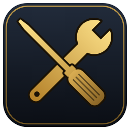
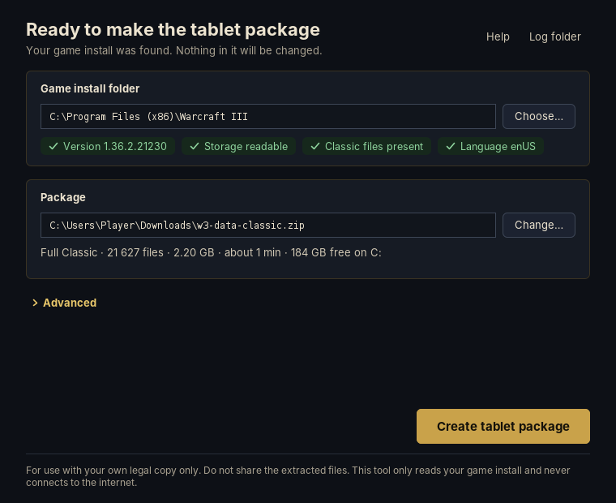
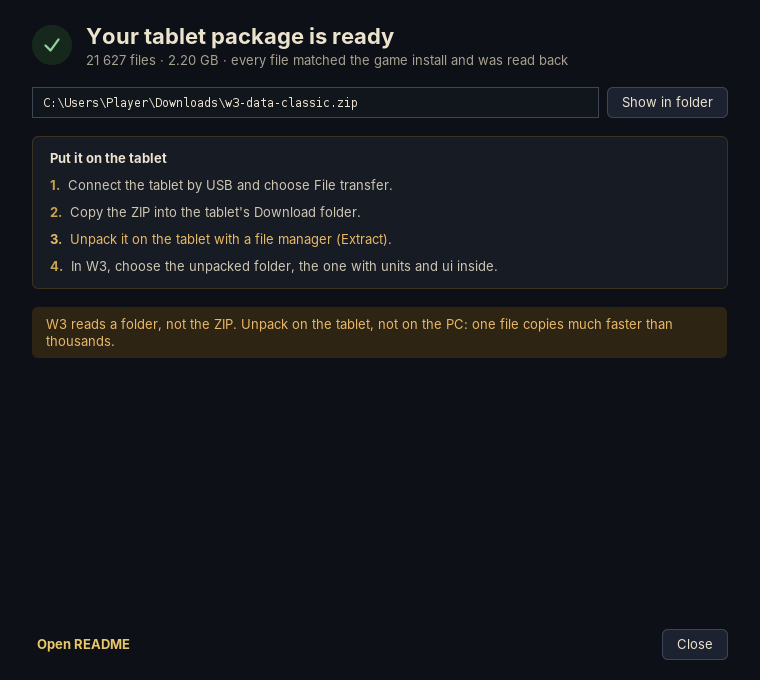
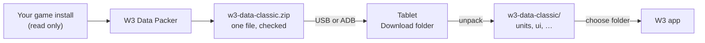
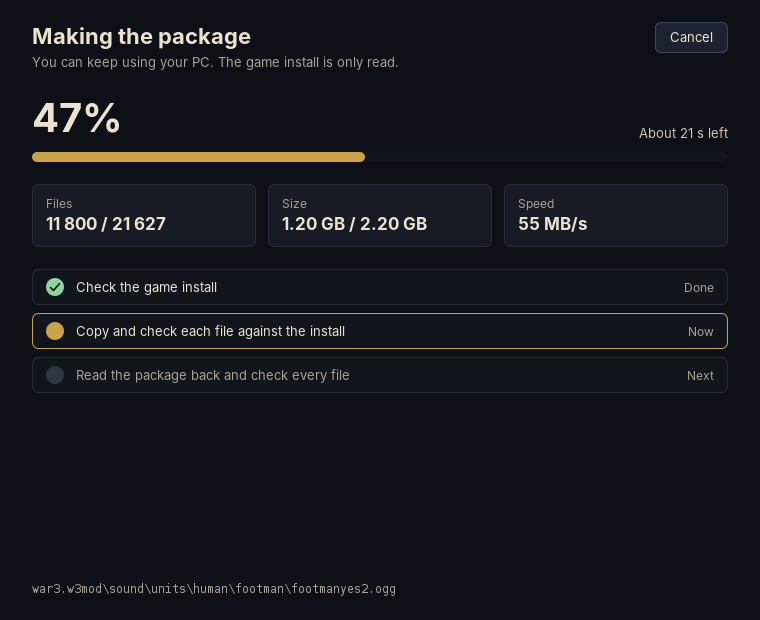
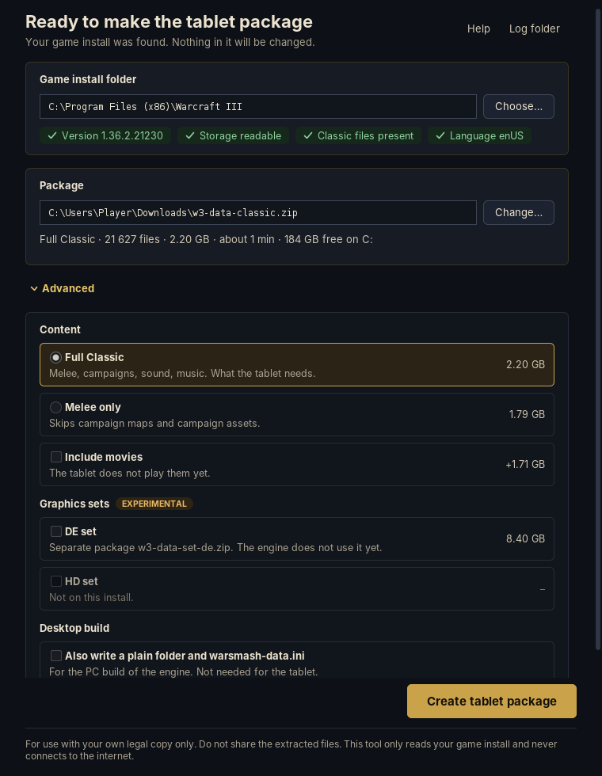

<div align="center">



# W3 Data Packer

**Packs the game files the W3 Android app needs, from your own game install, into one ZIP.**

[](https://github.com/nikoltu/W3-Android-prep-tool/releases/latest)
[](https://github.com/nikoltu/W3-Android-prep-tool/actions/workflows/build.yml)


[](LICENSE)

&nbsp;


</div>

---

## What it does

The W3 Android app reads the classic game files from a folder on the tablet. Those files only exist inside your
own installed copy of the game. This tool takes the ~2.2 GB the tablet needs out of that install and packs them
into **one ZIP file**.



| | |
| --- | --- |
| **Reads only** | Your game install is never changed. Nothing is decrypted or converted. |
| **Offline** | No internet connection, no updates, no telemetry. |
| **Checked** | Every file is checked against the install while reading, and the ZIP is read back and checked before you get it. |
| **One file** | One ZIP copies to a tablet much faster than 21 627 small files. |
| **Your language** | Uses the game language your install has downloaded; English when it is there. |
| **No installer** | Unpack and run. Settings and logs stay in the tool's own folder. |

## How to use

### 1. Download

Get the file for your system from the [latest release](https://github.com/nikoltu/W3-Android-prep-tool/releases/latest):

| System | File | Start |
| --- | --- | --- |
| Windows 10 / 11, 64-bit | `W3-DataPacker-0.1.0-windows-x64.zip` | `W3-DataPacker.exe` |
| macOS, Apple Silicon | `W3-DataPacker-0.1.0-macos-arm64.zip` | `W3-DataPacker.app` |
| Linux, x64 | `W3-DataPacker-0.1.0-linux-x64.tar.gz` | `W3-DataPacker/bin/W3-DataPacker` |
| Any system with Java 17+ | `w3-datapacker-0.1.0-all.jar` | `java -jar w3-datapacker-0.1.0-all.jar` |

Unpack it anywhere and start it.

> [!NOTE]
> The `.jar` needs Java 17 or newer installed. The Windows, macOS and Linux packages include their own Java and
> need nothing installed, so they are the easier choice.

<details>
<summary><b>First start: Windows, macOS and Linux warnings</b></summary>

- **Windows:** if you see "Windows protected your PC", check that the file came from this project's Releases
  page, then choose **More info** → **Run anyway**.
- **macOS:** the app is not notarized. Right-click `W3-DataPacker.app` → **Open** → **Open**. Or, in Terminal:
  `xattr -dr com.apple.quarantine W3-DataPacker.app`
- **Linux:** `tar -xzf W3-DataPacker-0.1.0-linux-x64.tar.gz && ./W3-DataPacker/bin/W3-DataPacker`

</details>

### 2. Make the package

The tool finds the game install by itself: the usual folders on Windows, `/Applications` on macOS, and Wine,
Lutris, Bottles, Steam and CrossOver folders on Linux and macOS. If it doesn't, press **Choose…** once and pick the
folder that contains `Data` and `.build.info`.

Press **Create tablet package**. After a minute or two `w3-data-classic.zip` is in your **Downloads** folder.



### 3. Copy it to the tablet

- **USB cable:** connect the tablet, choose **File transfer** on it, copy `w3-data-classic.zip` into its
  **Download** folder.
- **ADB** (only if you already use it): press **Send to tablet** in the tool, or run
  `adb push w3-data-classic.zip /sdcard/Download/`

### 4. Unpack it on the tablet

> [!IMPORTANT]
> **W3 reads game files from a folder, not from the ZIP. The ZIP must be unpacked on the tablet.**
> Copy the ZIP itself; don't unpack it on the PC.

1. Open a file manager on the tablet, for example Files by Google.
2. Go to **Download**, tap `w3-data-classic.zip`, choose **Extract**.
3. You get a folder `w3-data-classic` with `units` and `ui` inside. This needs about 2.2 GB of extra free space.

> [!NOTE]
> The package contains a `.nomedia` file, so game sounds and pictures don't show up in your music or gallery apps.

### 5. Point W3 at the folder

Open W3, go to its data folder setting and choose `w3-data-classic`, the folder that directly contains `units`
and `ui`. When W3 starts, you can delete the ZIP.

> [!TIP]
> After a game update, run the tool again, copy and unpack the new ZIP, and point W3 at the new folder.

<details>
<summary><b>Advanced options</b></summary>

<br>


| Option | What it does |
| --- | --- |
| **Melee only** | Leaves out campaign maps and campaign assets. |
| **Include movies** | Adds the cinematics. The tablet doesn't play them yet. |
| **Graphics sets** *(experimental)* | DE and HD sets, each as its own ZIP (`w3-data-set-de.zip`, `w3-data-set-hd.zip`). Unpack into the same folder as Classic; the files go into their own subfolder and don't overwrite Classic. The engine doesn't use them yet. |
| **Desktop build** | Also writes a plain `w3-data-classic` folder and `warsmash-data.ini` for the PC build of the engine. |

Next to each ZIP the tool writes a `.manifest.json` with every file's size and checksums. It stays on the PC.

</details>

<details>
<summary><b>Problems</b></summary>

| Message | What to do |
| --- | --- |
| This folder has no .build.info | Pick the folder that contains `Data` and `.build.info`. |
| Files could not be read | Let the game launcher finish updating, or run its Scan and Repair, then try again. |
| The game was updated while packing | Let the update finish, then press **Try again**. |
| Not enough space | Choose another place for the package, or free some space. |
| **Extract** fails on the tablet | Check free space; copy the ZIP again. |
| W3 says the folder is not valid | Pick the folder that directly contains `units` and `ui`. |

**Log folder** in the tool opens the logs. Your user folder shows as `~` in them, so a log can be shared for help.

</details>

<details>
<summary><b>Command line</b></summary>

`W3-DataPacker-cli` (next to the app) does the same without a window:

```
W3-DataPacker-cli [--install <folder>] [--out <folder>] [--melee] [--movies]
                  [--set de|hd] [--desktop-folder] [--dry-run] [--send]
```

`--dry-run` writes nothing. It lists what would be packed by folder and by layer, the language, and checks a
sample of files, so the numbers can be compared with an earlier extraction. With the jar: `java -jar w3-datapacker-0.1.0-all.jar --cli …`

</details>

<details>
<summary><b>Building from source</b></summary>

Needs JDK 17 or newer.

```
./gradlew test          # unit tests on synthetic storage, no game files
./gradlew run           # start the window
./gradlew distArchive   # app image + archive for this OS in build/distributions
./gradlew allJar        # one jar for any OS
./gradlew screenshots   # renders every screen with sample data into build/screens
```

The app image is a trimmed `jlink` runtime with a standard `jpackage` launcher: no installer and no
self-extracting step. Pushing a `v*` tag builds Windows, macOS and Linux packages and publishes a release.

</details>

## LEGAL

> [!CAUTION]
> **For use with your own legal copy only. Do not share the extracted files or the package.**

- This is an unofficial fan project. It is not affiliated with, endorsed or supported by Blizzard Entertainment.
- Warcraft and Blizzard are trademarks of Blizzard Entertainment, Inc. They are named here only to say which game
  install the tool reads.
- This repository and its releases contain code only, no game files. The tool reads a local install and does not
  download anything from any server.
- The tool does not bypass any protection: encrypted data is never decoded, and the code holds no keys.
- Licensed under [AGPL-3.0](LICENSE). The CASC reader in `com.hiveworkshop` comes from the
  [Warsmash](https://github.com/Retera/WarsmashModEngine) engine by Retera and contributors, under the same licence.
