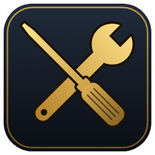
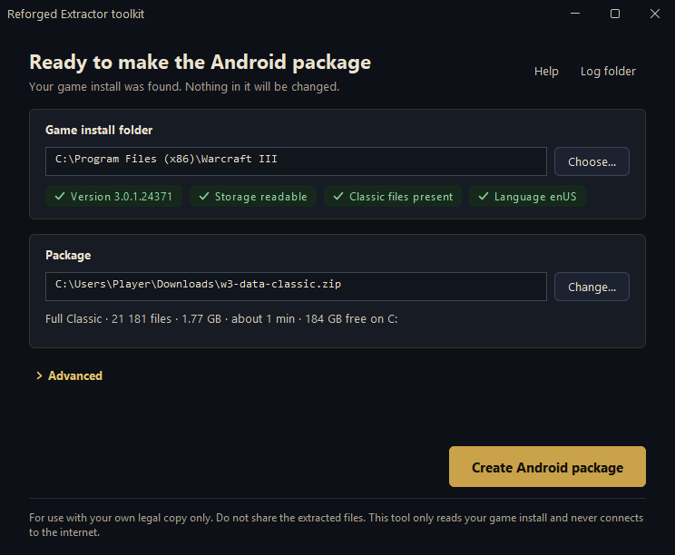
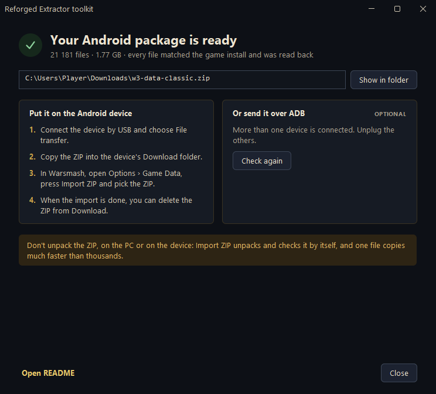
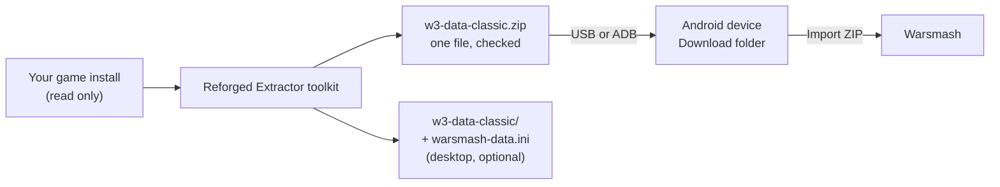
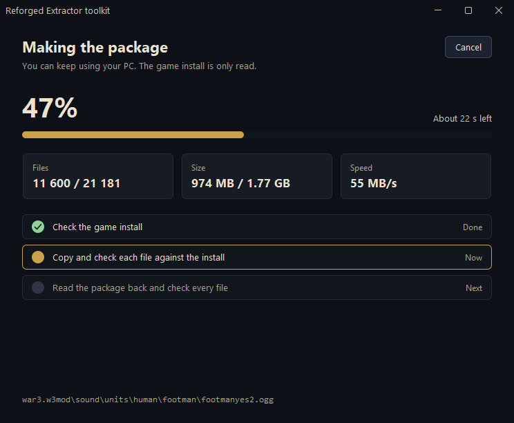
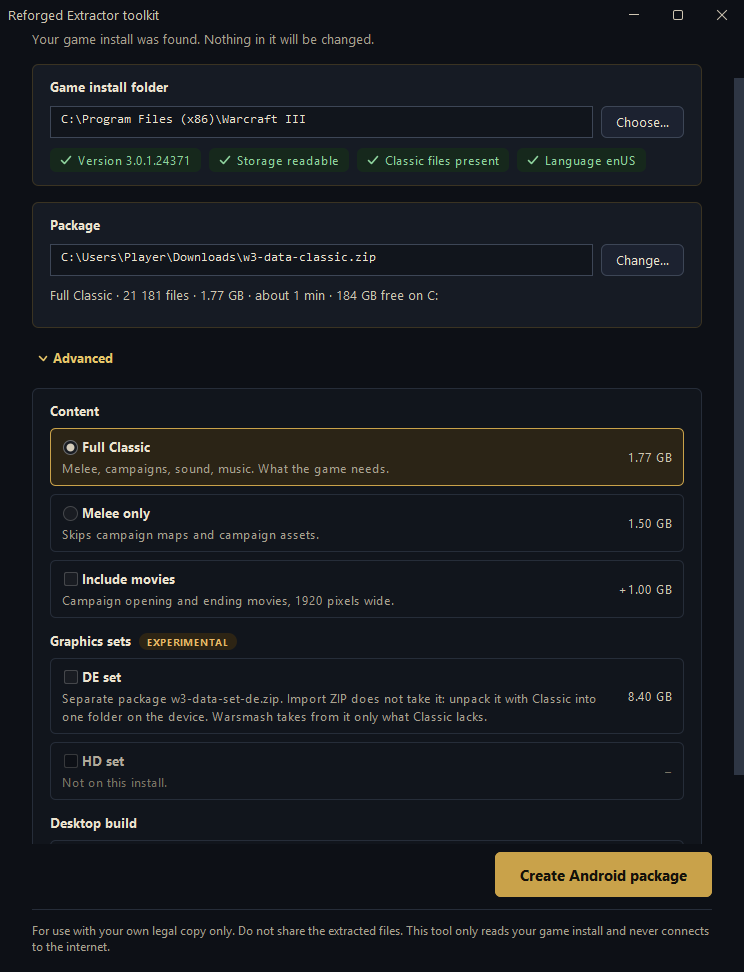

<div align="center">



# Reforged Extractor toolkit

**Takes the game files Warsmash needs, on Android and on the desktop, out of your own Warcraft III install.**

[](https://github.com/nikoltu/W3-Android-prep-tool/releases/latest)
[](https://github.com/nikoltu/W3-Android-prep-tool/actions/workflows/build.yml)


[](LICENSE)

&nbsp;


</div>

---

## What it does

Warsmash reads the Classic game files from a folder. Those files only exist inside your own installed copy of
Warcraft III (1.32 or newer, the Reforged storage). This tool takes out exactly the files Warsmash reads, about
2.1 GB, and packs them into **one ZIP file** for an Android device. For the desktop build of Warsmash it can also
write them as a plain folder.



| | |
| --- | --- |
| **Reads only** | Your game install is never changed. Nothing is decrypted or converted. |
| **Only what is used** | Leaves out what Warsmash does not read: the Battle.net web client, Reforged shaders and particle effects, the Reforged campaigns and their in-engine cinematics, and the fonts of languages you don't use. |
| **Offline** | No internet connection, no updates, no telemetry. |
| **Checked** | Every file is checked against the install while reading, and the ZIP is read back and checked before you get it. |
| **One file** | One ZIP copies to a device much faster than 21 000 small files. |
| **Your language** | Uses the game language your install has downloaded; English when it is there. |
| **No installer** | Unpack and run. |

### What the package holds

| Part | Size (3.0.1, English) | Why |
| --- | --- | --- |
| Classic game data: units, doodads, interface, sound, music, maps, scripts | ~1.5 GB | The game itself. |
| Classic campaigns and their spoken lines | ~0.15 GB | Left out with **Melee only**. |
| `_de.w3mod/`: the files Classic graphics take from the DE set (weather and blood effects, cinematic heroes, items and effects of newer abilities, bridge textures) with the textures those models name | ~0.37 GB | Classic data names them, and the Classic files don't have them. |
| `_hd.w3mod/ui/`: the Reforged cinematic portrait frame | tiny | The Reforged look of cinematics. |
| `webui/`: menu and campaign scenes (Classic `_sd` and Reforged `.webm`), Reforged interface art, portraits, loading screens | ~0.27 GB | The launcher's animated backgrounds, its Reforged look and the Reforged loading screen. |
| `movies/` *(optional)* | ~1.0 GB | Campaign opening and ending movies in one width, with their sound and captions. |
| `w3-datapacker.txt` | tiny | Written last. Names the tool, the **game version** and the language, which Warsmash shows; a folder without it was not fully unpacked. |

The experimental graphics sets (Advanced) are separate packages:

| Package | Holds | Size (3.0.1, English) |
| --- | --- | --- |
| `w3-data-set-hd.zip` | `_hd.w3mod/`: the Reforged (HD) set, plus the ~250 files of the DE set that Reforged graphics take when the HD set has none (`_de.w3mod/`, ~0.14 GB) | ~47.8 GB |
| `w3-data-set-de.zip` | `_de.w3mod/`: the DE set, plus the one HD model the DE graphics take (`_hd.w3mod/`) | ~47.0 GB |

## How to use

### 1. Download

Get the file for your system from the [latest release](https://github.com/nikoltu/W3-Android-prep-tool/releases/latest):

| System | File | Start |
| --- | --- | --- |
| Windows 10 / 11, 64-bit | `Reforged-Extractor-0.2.0-windows-x64.zip` | `Reforged-Extractor.exe` |
| macOS, Apple Silicon | `Reforged-Extractor-0.2.0-macos-arm64.zip` | `Reforged-Extractor.app` |
| Linux, x64 | `Reforged-Extractor-0.2.0-linux-x64.tar.gz` | `Reforged-Extractor/bin/Reforged-Extractor` |
| Any system with Java 17+ | `reforged-extractor-0.2.0-all.jar` | `java -jar reforged-extractor-0.2.0-all.jar` |

Unpack it anywhere and start it.

> [!NOTE]
> The `.jar` needs Java 17 or newer installed. The Windows, macOS and Linux packages include their own Java and
> need nothing installed, so they are the easier choice.

<details>
<summary><b>First start: Windows, macOS and Linux warnings</b></summary>

- **Windows:** if you see "Windows protected your PC", check that the file came from this project's Releases
  page, then choose **More info** → **Run anyway**.
- **macOS:** the app is not notarized. Right-click `Reforged-Extractor.app` → **Open** → **Open**. Or, in Terminal:
  `xattr -dr com.apple.quarantine Reforged-Extractor.app`
- **Linux:** `tar -xzf Reforged-Extractor-0.2.0-linux-x64.tar.gz && ./Reforged-Extractor/bin/Reforged-Extractor`

</details>

### 2. Make the package

The tool finds the game install by itself: the usual folders on Windows, `/Applications` on macOS, and Wine,
Lutris, Bottles, Steam and CrossOver folders on Linux and macOS. If it doesn't, press **Choose…** once and pick the
folder that contains `Data` and `.build.info`.

Press **Create Android package**. After a minute or two `w3-data-classic.zip` is in your **Downloads** folder.



### 3. Copy it to the Android device

- **USB cable:** connect the device, choose **File transfer** on it, copy `w3-data-classic.zip` into its
  **Download** folder.
- **ADB** (only if you already use it): press **Send to device** in the tool, or run
  `adb push w3-data-classic.zip /sdcard/Download/`

### 4. Import it in Warsmash

> [!IMPORTANT]
> **Don't unpack the ZIP, neither on the PC nor on the device.** Warsmash imports the ZIP itself: it unpacks it into
> its own app folder and checks every file. One file also copies much faster than thousands.

1. Open Warsmash. On the **Game data** screen it shows at first start (later: Options › Game Data) press
   **Import ZIP**.
2. Pick `w3-data-classic.zip` in **Download**.
3. Wait until the import is done. It needs about 2.1 GB of extra free space (3.1 GB with movies). Warsmash then
   shows the game version from the package.

When the import is done, you can delete the ZIP.

> [!NOTE]
> The package contains a `.nomedia` file, so game sounds and pictures don't show up in your music or gallery apps.

> [!TIP]
> After a game update, run the tool again, copy the new ZIP to the device and import it the same way. It replaces
> the old data; until the new import is done, the old data stays as it was.

## Desktop Warsmash

Open **Advanced** and tick **Also write a plain folder and warsmash-data.ini** (command line: `--desktop-folder`).
Next to the ZIP you then get:

- `w3-data-classic/`: the same files as the ZIP, unpacked. In the desktop launcher choose this folder
  (Options › Game Data › Change…).
- `warsmash-data.ini`: names that folder as the game data. Start the engine with `-ini <path>\warsmash-data.ini`;
  the engine takes every other setting from its own `warsmash.ini`.

The folder is written beside its final place and only then put there, so a run that stops halfway keeps the earlier
folder. The tool replaces only a folder it made itself.

<details>
<summary><b>Advanced options</b></summary>

<br>


| Option | What it does |
| --- | --- |
| **Melee only** | Leaves out the campaign maps, campaign assets, their spoken lines and mission pictures. |
| **Include movies** | Adds the campaign opening and ending movies, 1920 pixels wide, with sound and captions. Warsmash plays them on Android. |
| **Graphics sets** *(experimental)* | DE and HD sets, each as its own ZIP (`w3-data-set-de.zip`, `w3-data-set-hd.zip`). Import ZIP takes only the Classic package: to use a set, unpack Classic and the set into one folder on the device with a file manager and choose that folder with Options › Game Data › Change…; the set's files go into their own subfolder and don't overwrite Classic. Warsmash takes from them only models and textures that Classic lacks. |
| **Desktop build** | See above. |

Next to each ZIP the tool writes a `.manifest.json` with every file's size and checksums. It stays on the PC.

</details>

<details>
<summary><b>Problems</b></summary>

| Message | What to do |
| --- | --- |
| This folder has no .build.info | Pick the folder that contains `Data` and `.build.info`. |
| Game version … is older than 1.32 | The tool reads the storage of 1.32 (Reforged) and newer. Update the game. |
| Files could not be read | Let the game launcher finish updating, or run its Scan and Repair, then try again. |
| The game was updated while packing | Let the update finish, then press **Try again**. |
| Not enough space | Choose another place for the package, or free some space. |
| Warsmash: not a ZIP file, incomplete, or does not match its checksum | The copy is damaged. Copy the ZIP to the device again and import it again. |
| Warsmash: not enough free space | Free the space it names on the device, then import again. |
| Warsmash: not a Reforged Extractor toolkit package | A graphics set ZIP or another ZIP was picked. Import `w3-data-classic.zip`. |
| Warsmash: the ZIP cannot be read where it lies | Copy it to the device storage, such as **Download**, and pick it there. |
| Warsmash says a chosen folder is not valid (Change…) | Pick the folder that directly contains `units` and `ui`. |
| Warsmash shows no exact game version | The package was made before version 0.2.0 of this tool; make it again. |

**Log folder** in the tool opens the logs. Your user folder shows as `~` in them, so a log can be shared for help.
Settings and logs are kept in `Reforged-Extractor` in your user's application data folder.

</details>

<details>
<summary><b>Command line</b></summary>

`Reforged-Extractor-cli` (next to the app) does the same without a window:

```
Reforged-Extractor-cli [--install <folder>] [--out <folder>] [--melee] [--movies] [--movie-width 1920|1280|640]
                       [--set de|hd] [--desktop-folder] [--dry-run] [--allow-missing] [--send]
```

`--dry-run` writes nothing. It lists what would be packed by folder and by layer, the language, and checks a
sample of files, so the numbers can be compared with an earlier extraction. `--movie-width` picks a smaller copy of
the movies for small screens. With the jar: `java -jar reforged-extractor-0.2.0-all.jar --cli …`

</details>

<details>
<summary><b>Building from source</b></summary>

Needs JDK 17 or newer.

```
./gradlew test          # unit tests on synthetic storage, no game files
./gradlew run           # start the window
./gradlew distArchive   # app image + archive for this OS in build/distributions
./gradlew allJar        # one jar for any OS
./gradlew screenshots   # renders every screen with sample data into build/screens
```

The app image is a trimmed `jlink` runtime with a standard `jpackage` launcher: no installer and no
self-extracting step. Pushing a `v*` tag builds Windows, macOS and Linux packages and publishes a release.

</details>

## LEGAL

> [!CAUTION]
> **For use with your own legal copy only. Do not share the extracted files or the package.**

- This is an unofficial fan project. It is not affiliated with, endorsed or supported by Blizzard Entertainment.
- Warcraft, Warcraft III: Reforged and Blizzard are trademarks of Blizzard Entertainment, Inc. They are named here
  only to say which game install the tool reads.
- This repository and its releases contain code only, no game files. The tool reads a local install and does not
  download anything from any server.
- The tool does not bypass any protection: encrypted data is never decoded, and the code holds no keys.
- Licensed under [AGPL-3.0](LICENSE). The CASC reader in `com.hiveworkshop` comes from the
  [Warsmash](https://github.com/Retera/WarsmashModEngine) engine by Retera and contributors, under the same licence.
